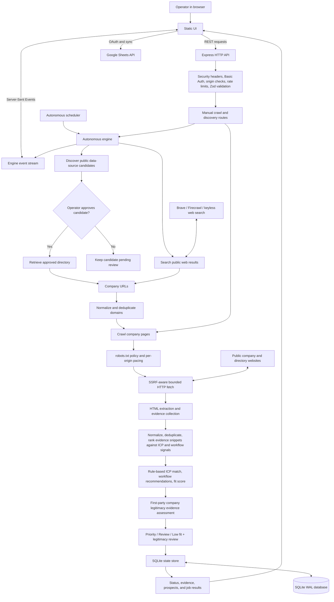

# ICP Scraper Architecture

This describes the current single-operator, single-server application. The crawler and scheduler run in the Node.js process; SQLite is the durable local store.

## System flow

## Runtime components

| Component | Responsibility |
| --- | --- |
| `public/index.html`, `public/app.js`, `public/styles.css` | Operator UI, configuration, crawl controls, status and evidence display |
| `server.js` | Express routes, orchestration, scheduler, extraction, scoring, and Google Sheets flow |
| `company-legitimacy.js` | Scores same-domain first-party website identity, marketing-business, contact, company-profile, and page-coverage evidence separately from ICP fit |
| `predictive-preprocessing.js` | Deterministic normalization, deduplication, signal ranking, bounded context selection, and provenance summary for crawled company text |
| `source-discovery.js` | Builds rotating source-search queries from saved ICP profiles |
| `safe-fetch.js` | Validates public HTTP(S) targets, DNS results, redirects, response type, size, and request timeout |
| `robots-policy.js` | Applies robots rules, caches them, and spaces requests by origin |
| `bounded-concurrency.js` | Limits concurrent company-site work |
| `background-task-tracker.js` | Tracks async work so shutdown can stop schedules and drain active jobs |
| `graceful-shutdown.js` | Orders signal shutdown, HTTP close, task drain, final persistence, and database close |
| `automation-recovery.js` | Selects interrupted source discovery and approved-directory retrieval jobs eligible for restart recovery |
| `state-store.js` | Persists ICPs, sources, jobs, companies, candidates, and discovery metadata in SQLite |
| `backup-database.js` | Produces a consistent SQLite online backup |

### Data path

The store has `records` and `metadata` tables. Records are JSON payloads keyed by collection and ID (`icps`, `sources`, `jobs`, `companies`, `sourceCandidates`); discovery and engine status are stored as metadata. Each snapshot is written transactionally. WAL mode and full synchronous commits are enabled.

Search results and extracted website text are untrusted evidence. A source candidate is not followed for company links until approved. Company evidence is scored against the saved ICP and displayed with its source; qualification tiers are prioritization, not proof of buying intent. The separate legitimacy assessment counts only pages hosted on the company's own domain; search snippets and directory pages cannot supply identity, contact, or profile evidence. Strong evidence requires corroborated company identity, marketing-business content, a public contact path present on first-party content, company-profile evidence, and at least two distinct first-party page paths. Automated discovery only counts these strong-evidence prospects as qualified; weaker results are retained for review, and directory-only records remain eligible for later website crawling. No result is represented as legally verified.

### Predictive context preparation

Before company evidence is extracted and scored, `predictive-preprocessing.js` normalizes crawled text, removes repeated and common boilerplate segments, and ranks the remaining snippets using Dakini workflow signals, operational indicators, and the configured ICP. A bounded, source-linked selection is passed to the existing rule-based extractor; one homepage snippet is reserved for company overview when available, and if no known signal matches, deduplicated snippets are retained in source order instead of silently discarding the page. The record exposes the selected sources, detected ranking signals, and context-reduction metrics for review.

This is deterministic, heuristic preprocessing—not an LLM call or a calibrated prediction. It currently prepares input for Dakini's existing rules-based prospect analysis; there is no LLM inference path in this repository. A future LLM feature can reuse the prepared, source-linked context as its prompt context, then validate generated claims against the same evidence. See [PREDICTIVE_PREPROCESSING_REPORT.md](./PREDICTIVE_PREPROCESSING_REPORT.md) for the review, limitations, proposed LLM architecture, evaluation plan, and references.

## Autonomous cycle

1. On startup, load SQLite state, re-score old saved records, recover eligible interrupted source-discovery, directory-retrieval, and web-discovery jobs, then schedule the engine.
2. New installations schedule the engine daily at `DISCOVERY_TIME` / `DISCOVERY_TIME_ZONE` (09:00 Asia/Kolkata by default). A saved operator-selected mode is retained. Manual **Run now** starts a cycle immediately.
3. A daily cycle discovers source candidates, retrieves approved/curated directories, runs public web searches, deduplicates domains, and crawls eligible company sites. Search queries are distributed across configured industries, with the extra daily query allocation rotating between sectors.
4. Extraction and scoring results, completed search-query indexes, candidate evidence, completed company domains, and error summaries are persisted. The UI receives live engine events over SSE.

`continuous` and `interval` modes are available, but can cause substantially more search and crawl activity. Provider quotas, robots rules, site availability, and public search indexes bound all results; the engine does not provide exhaustive web coverage.

## Restart and shutdown behavior

- `SIGINT` / `SIGTERM` stop scheduler timers and the event stream, close the HTTP listener, drain tracked background tasks, persist state, and close SQLite.
- Interrupted source-discovery scans, approved-directory retrievals, and broad web-discovery jobs resume after restart.
- Web discovery stores completed query indexes and candidate evidence, then checkpoints completed company domains to avoid repeating successful work. A search interrupted before its checkpoint may be issued again; website fetch failures remain retryable.
- Google OAuth credentials are held in memory and need reconnection after restart.

The scheduler, job execution, SQLite file, and Google OAuth session are all single-process/single-server resources. This is not a multi-tenant or multi-instance architecture.

## Production boundary

The supported deployment is one trusted operator behind an HTTPS reverse proxy, with Basic Authentication, one Node process, and a persistent local SQLite volume. See [README.md](./README.md) for deployment and backup procedures. A multi-user service would require a different identity/tenant model, a durable external queue, shared database, persistent OAuth credential storage, and distributed scheduling.
